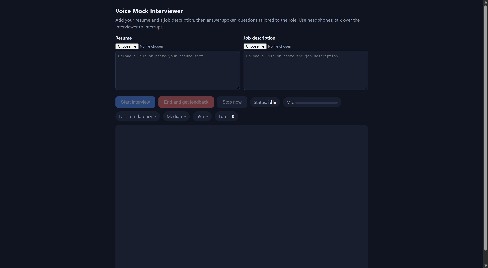

# Voice Mock Interviewer

Practise a job interview out loud, for the exact role you are applying to. Upload (or paste) your **resume** and the **job description**, and an AI interviewer built from those two documents asks you spoken questions, probes the gaps between your resume and the role, and gives feedback at the end.

A browser page streams your microphone to a FastAPI backend, which relays audio to **Gemini 3.8 Live** (speech-to-speech) and plays the interviewer's replies back.



## Features
- **Dynamic persona:** the interviewer is generated per session from your resume and the job description (PDF, DOCX, TXT, MD or pasted text). Nothing about a specific role or person is baked into the code.
- **Speech-to-speech interviewer** with a persona prompt (`persona.md`) that asks one spoken question at a time and probes vague answers.
- **Barge-in:** talk over the interviewer and playback stops immediately.
- **Live transcript** of both sides, saved to `transcripts/` (git-ignored).
- **Turn latency readout** (last / median / p95): time from the end of your speech to the first interviewer audio. This is a rough, browser-side measurement.
- **End and get feedback:** spoken feedback with strengths, gaps to study and a score.

## Architecture
```
Browser (mic 16 kHz PCM, AudioWorklet)  <--WebSocket-->  FastAPI  <--Live API-->  gemini-3.8-live
        plays 24 kHz PCM, handles barge-in
```
- Input audio: 16-bit PCM, 16 kHz, mono, sent in ~100 ms chunks. Output: 24 kHz PCM.
- Echo cancellation, noise suppression and auto gain control come from the browser's WebRTC audio processing (`getUserMedia` constraints). There is no server-side DSP, so **use headphones**.
- Turn detection and interruption handling are done by the model; the app only flushes playback on the `interrupted` event.

## Run
Requires Python 3.10+ and a Gemini API key from [Google AI Studio](https://aistudio.google.com/api-keys).

```bash
python -m venv .venv
.venv\Scripts\pip install -r requirements.txt      # Windows (use .venv/bin/pip elsewhere)
copy .env.example .env                             # then put your key in .env
.venv\Scripts\python -m uvicorn server:app --host 127.0.0.1 --port 8800
```
Open http://127.0.0.1:8800, click **Start interview**, and allow the microphone. On Windows, `run.bat` starts the server and opens the page.

Config via `.env`: `GEMINI_API_KEY`, optional `LIVE_MODEL` (default `gemini-3.8-live`) and `VOICE` (default `Aoede`).

## Customising
`persona.md` is the interviewer prompt template. `{{RESUME}}` and `{{JOB_DESCRIPTION}}` are filled in at session start. Edit it to change the interview style, number of questions or feedback format.

## Privacy
- Your resume and job description are sent to the Gemini API as part of the session prompt. They are not stored by this app.
- The text boxes are remembered in your own browser (`localStorage`) for convenience; clear them to forget.
- Transcripts are written to `transcripts/` on your machine (git-ignored).
- Your API key stays in the server's `.env` and never reaches the browser.

## Limitations
- Free-tier Live API limits apply (see your AI Studio rate-limit page).
- Latency numbers are measured in the browser and include audio buffering, so treat them as indicative.
- Echo handling relies on the browser; laptop speakers can cause the interviewer to hear herself.
- No authentication: it is meant to run locally. Each document is truncated to 20,000 characters.
- Scanned (image-only) PDFs have no extractable text; paste the text instead.
